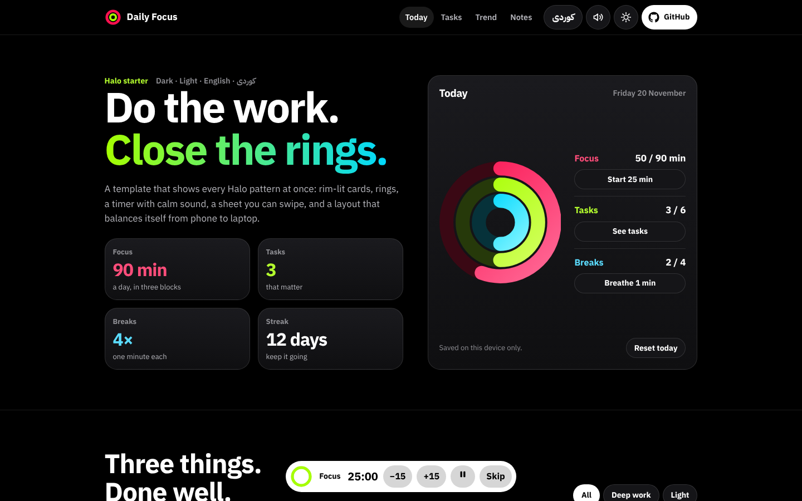
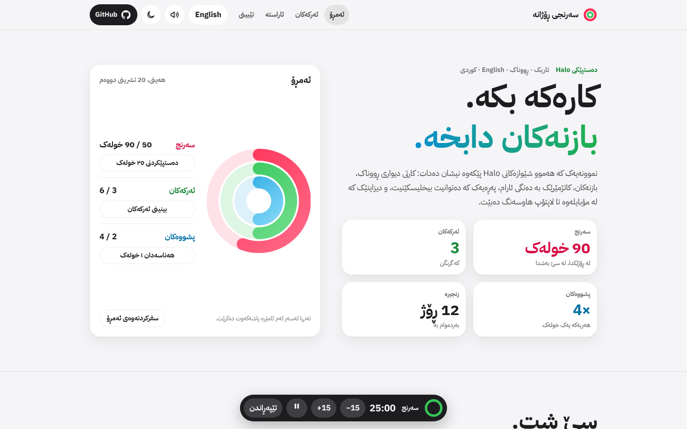
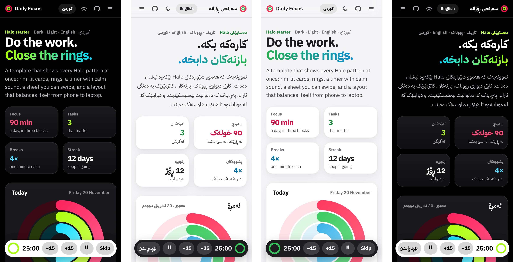
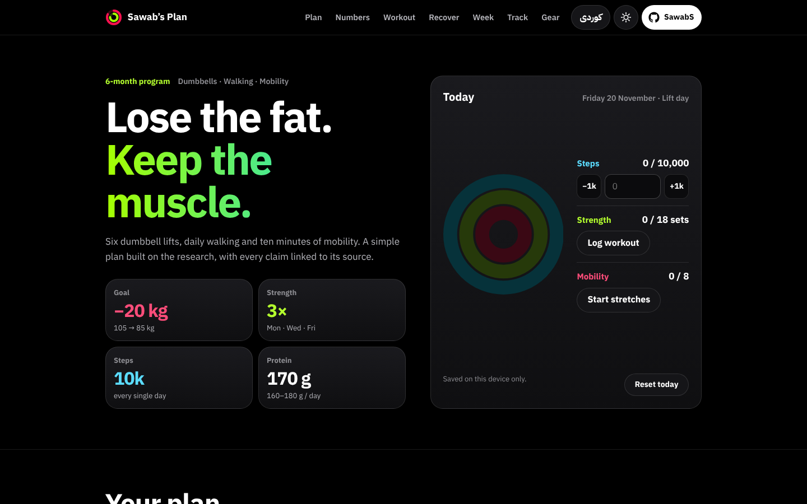
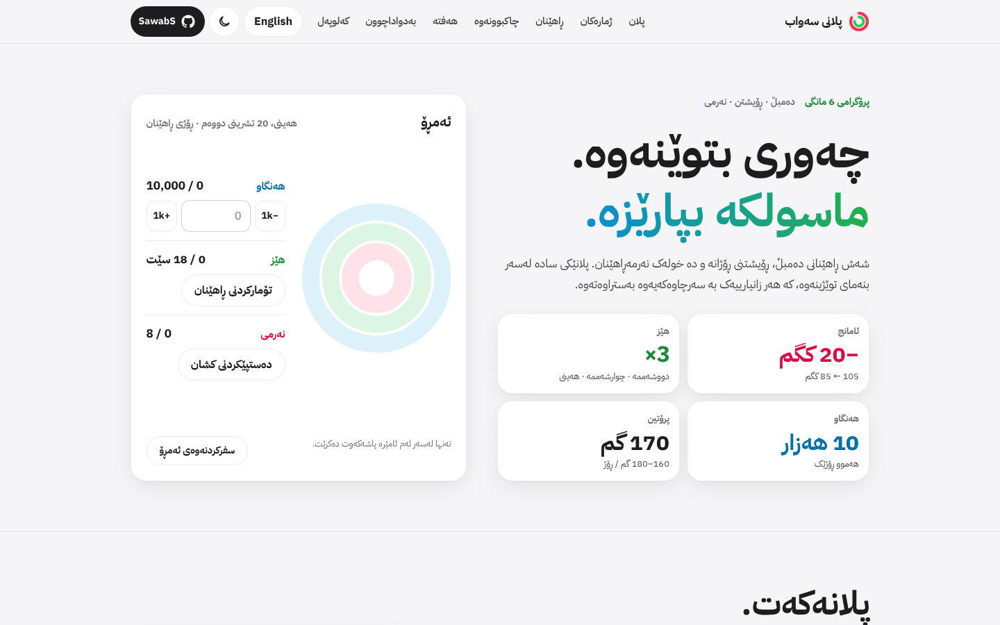
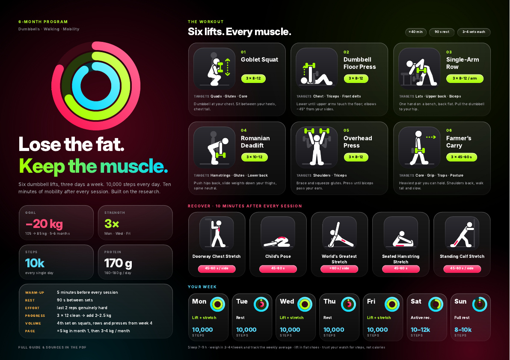
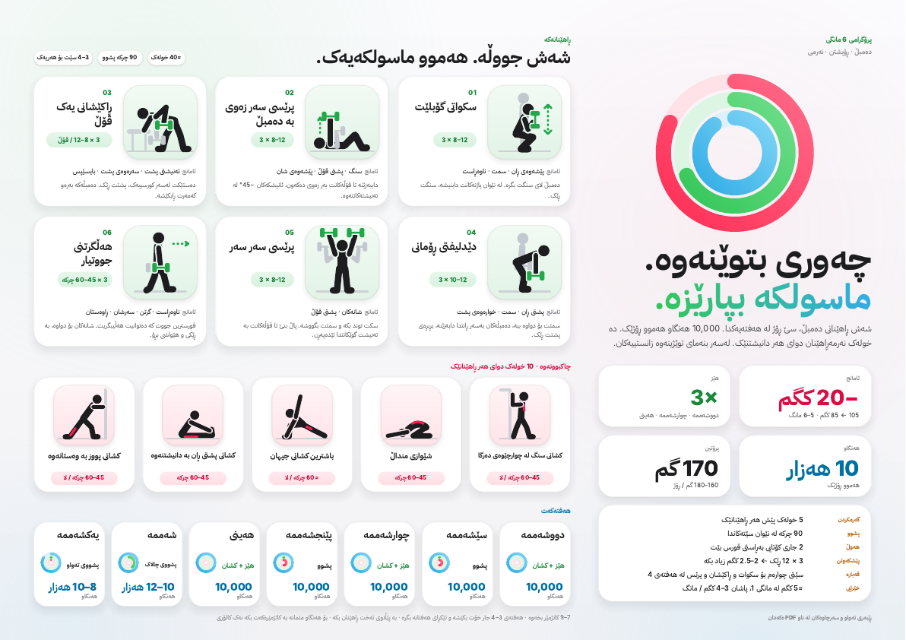

# Halo · design skill for AI agents

**Calm, glossy, bilingual interfaces that feel alive.** Activity rings, rim-lit cards, big accent numbers, quiet motion and soft synthesized sound, in dark and light, English and Kurdish (Sorani), on phone and laptop, and in true vector PDF.

Halo is packaged as an **agent skill**: drop the folder into your agent's skills directory and it will build interfaces that follow the system, using web standards and established production libraries rather than code invented from memory.



| | |
|---|---|
|  |  |
|  |  |
|  |  |

## What's inside

| | |
|---|---|
| **Tokens** | One `tokens.css` using `light-dark()`, plus [DTCG 2025.10](https://www.designtokens.org/tr/2025.10/) JSON for Figma, Style Dictionary and native apps |
| **Components** | Nav with scroll progress, stat tiles, activity rings, cards with pinned footers, chips, filters, segmented control, stepper, check dots, KPI row, charts, sources list, sheet dialog, timer pill, toast |
| **Motion & light** | Pointer-tracked rim light (the "spotlight card" pattern), gentle tilt, touch glint, staggered reveal on scroll, hero drift, one easing curve, reduced-motion safe |
| **Phone UX** | Quiet 40 px nav, menu-held settings, swipe between items, haptics, safe areas |
| **RTL & Kurdish** | IBM Plex Sans Arabic, logical properties, mirrored charts and timers, Sorani dates, bidi rules, translation workflow |
| **Sound** | Music-box notes, singing bowls, water drops and a breathing ambient pad, all synthesized with Web Audio in one pentatonic key; opt-out toggle |
| **Icons** | Lucide-compatible UI icons, glyphs, and a pictogram grammar for "explain a movement" illustrations |
| **Print** | HTML → vector PDF pipeline with zero raster images, vector shadows, RTL auto-fit and a verifier |
| **QA** | Playwright suites for layout (9 widths × 2 themes × 2 languages) and phone touch; a reference checklist that found real bugs |

## Install as a skill

**Claude Code / Claude apps:** copy the folder to your skills directory:
```bash
git clone https://github.com/SawabS/halo-design-skill ~/.claude/skills/halo-design
# or per project
git clone https://github.com/SawabS/halo-design-skill .claude/skills/halo-design
```
The agent reads [`SKILL.md`](SKILL.md) when a task matches its description, or when you ask for "the Halo style".

**Other agents (Codex, Cursor, Windsurf…):** point them at `SKILL.md` (an [`AGENTS.md`](AGENTS.md) is included for tools that look for it).

**By hand:** open `templates/starter.html` through any local server (`python3 -m http.server`) and build from it.

## Quick start (no build step)
```html
<link href="https://fonts.googleapis.com/css2?family=Google+Sans:wght@400..700&family=IBM+Plex+Sans+Arabic:wght@400;500;600;700&display=swap" rel="stylesheet">
<link rel="stylesheet" href="tokens/tokens.css">
<link rel="stylesheet" href="css/halo.css">
<script src="js/halo.js"></script>
<script src="js/halo-sound.js"></script>
<script>
  Halo.init({ dict: { en: { hello: "Hello" }, ckb: { hello: "سڵاو" } } });
</script>
```
React / Next.js / Tailwind v4 / shadcn: see [`docs/17-frameworks.md`](docs/17-frameworks.md).

## Built on standards and proven libraries
Halo's own runtime uses only Baseline web-platform APIs: `light-dark()`, `<dialog>`, IntersectionObserver, ResizeObserver, Pointer Events, Intl, Web Audio and the Vibration API. Where a production library is the better tool, the docs name it and map Halo onto it: Motion, GSAP ScrollTrigger, Lenis, Magic UI, vanilla-tilt, Lucide, Tone.js, ECharts, Playwright, axe-core, Style Dictionary and Fontsource. The full map is in [`docs/16-libraries.md`](docs/16-libraries.md).

## Repository layout
```
SKILL.md            ← agent entry point
tokens/             tokens.css + DTCG JSON
css/halo.css        components, motion, phone, RTL, print
js/halo.js          runtime (no dependencies)
js/halo-sound.js    calm synthesized sound
templates/          starter.html · print-a4.html
icons/              ui · glyphs · pictograms · README (grammar) · index.html (gallery)
docs/               01–17, one concern per file
qa/                 qa_layout.py · qa_touch.py
scripts/            print_pdf.py · verify_pdf.sh · build_tokens.py
fonts/              IBM Plex Sans Arabic + Inter (TTF, OFL) for offline and print use
examples/workout-plan/   the reference product: site + 4 vector PDFs
```

## The reference product
`examples/workout-plan` is the project Halo was extracted from: a six-month workout plan as an interactive site (rings, workout logger with rest timer, guided stretch player, projection calculator, weigh-in tracker, sources) and as 10-page vector PDFs in English and Kurdish, dark and light. It passed 606 scripted interaction checks plus the layout and touch suites.

## Licences
- Halo code and docs: [MIT](LICENSE).
- Fonts in `fonts/`: SIL Open Font License 1.1 (licence files next to the fonts). Google Sans is loaded from Google Fonts (OFL).
- Third-party projects referenced in the docs keep their own licences; see [`NOTICE.md`](NOTICE.md).

Made by [Sawab Hussein](https://github.com/SawabS).
