<p align="center">
  <picture>
    <source media="(prefers-color-scheme: dark)" srcset="docs/assets/banner-dark.png">
    <source media="(prefers-color-scheme: light)" srcset="docs/assets/banner-light.png">
    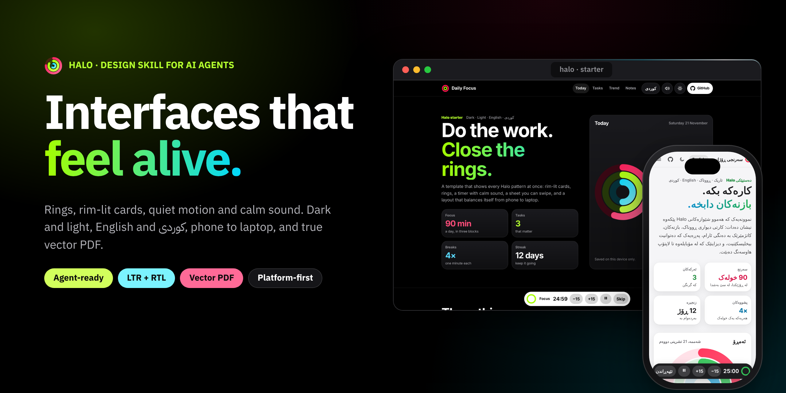
  </picture>
</p>

<p align="center">
  <a href="LICENSE"></a>
  
  
  
  
  
</p>

<p align="center">
  <b>Calm, glossy, bilingual interfaces that feel alive, designed per product.</b><br>
  Rim-lit cards · numbers first · a signature visual per product · quiet motion · calm synthesized sound · English and Kurdish (RTL) · phone to laptop · true vector PDF
</p>

<p align="center">
  <a href="#install-as-a-skill">Install</a> ·
  <a href="#quick-start">Quick start</a> ·
  <a href="#whats-inside">What's inside</a> ·
  <a href="docs/01-principles.md">Docs</a> ·
  <a href="#the-reference-product">Example</a>
</p>

<br>

<p align="center">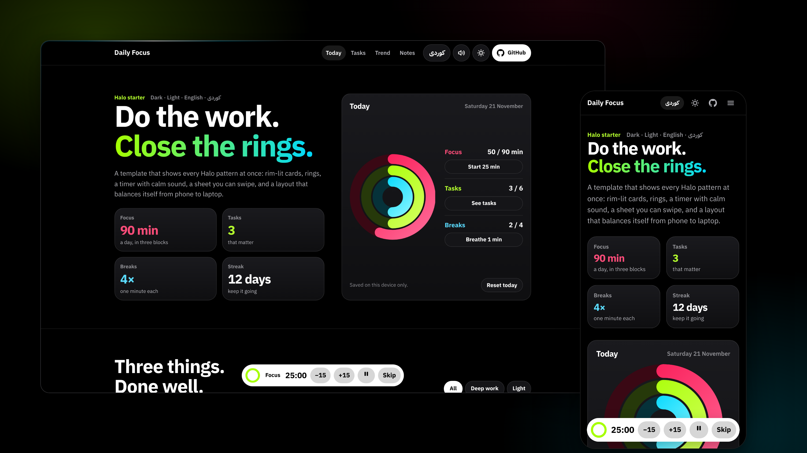</p>

## Why Halo

AI agents can produce a lot of UI fast, and much of it looks the same: generic cards, random gradients, layouts that break on phones and ignore right-to-left languages. **Halo** gives an agent a complete, opinionated design system *and the rules for applying it*, so every screen it builds:

- **fits its product**: the agent writes a short brief and picks the signature visual, accent meanings and illustrations for *this* app, so a finance tool, a course and a server dashboard each look like themselves;
- **looks deliberate**: three accent roles, one easing curve, numbers as the headline;
- **feels alive**: light follows the pointer, cards arrive once, timers chime softly;
- **works for everyone**: dark and light, English and Kurdish, 320 px to 1440 px, keyboard and screen readers;
- **is built on standards**: web-platform APIs first, then the production library that is already the standard for each job; nothing invented from memory;
- **ships tested**: a scripted QA protocol that tries to break it before your users do.

## What's inside

<table>
  <tr>
    <td width="50%"><a href="docs/06-motion-and-light.md">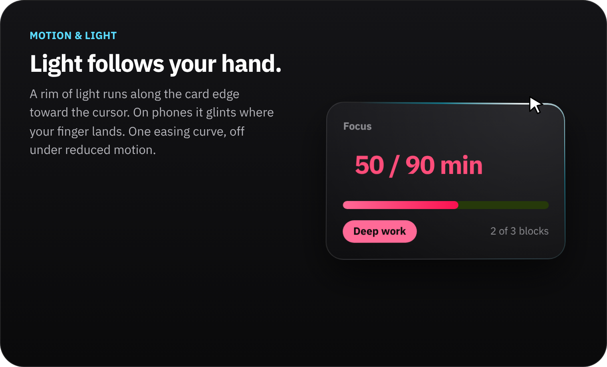</a></td>
    <td width="50%"><a href="docs/00-creative-direction.md">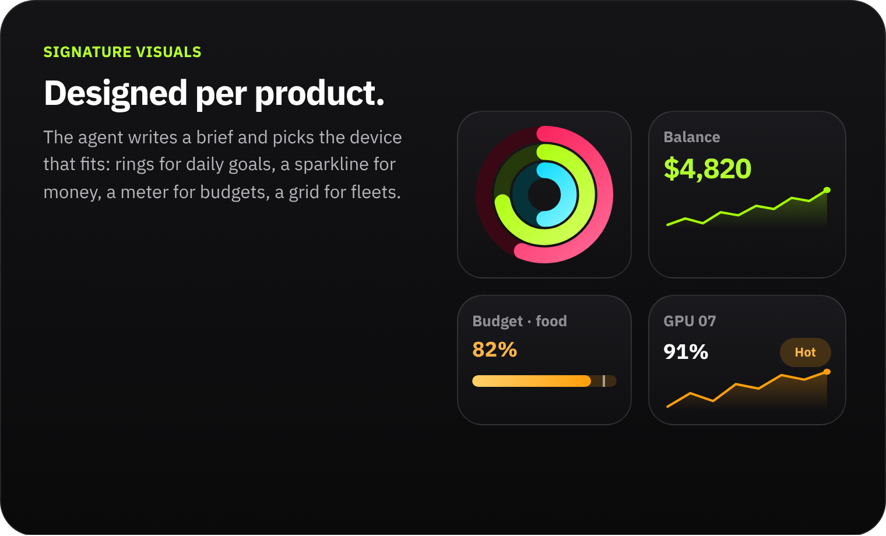</a></td>
  </tr>
  <tr>
    <td><a href="docs/08-rtl-and-kurdish.md">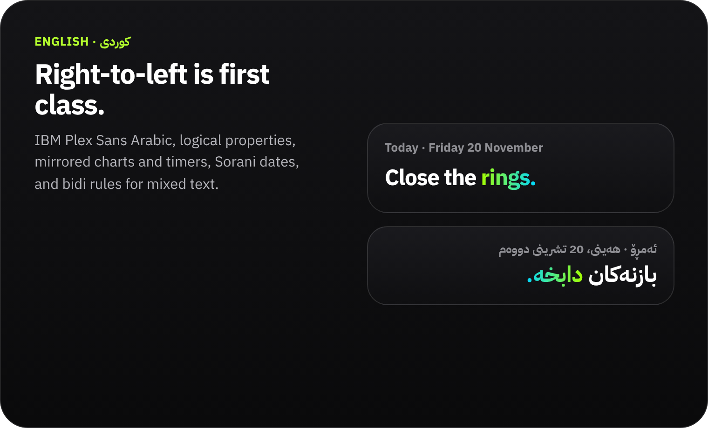</a></td>
    <td><a href="docs/07-phone-and-touch.md">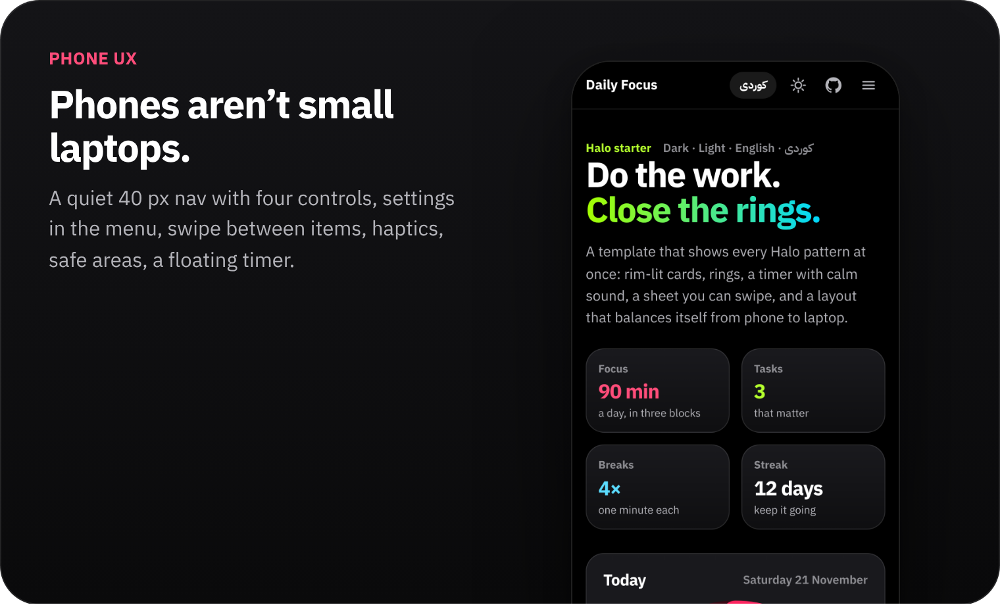</a></td>
  </tr>
  <tr>
    <td><a href="docs/14-sound.md">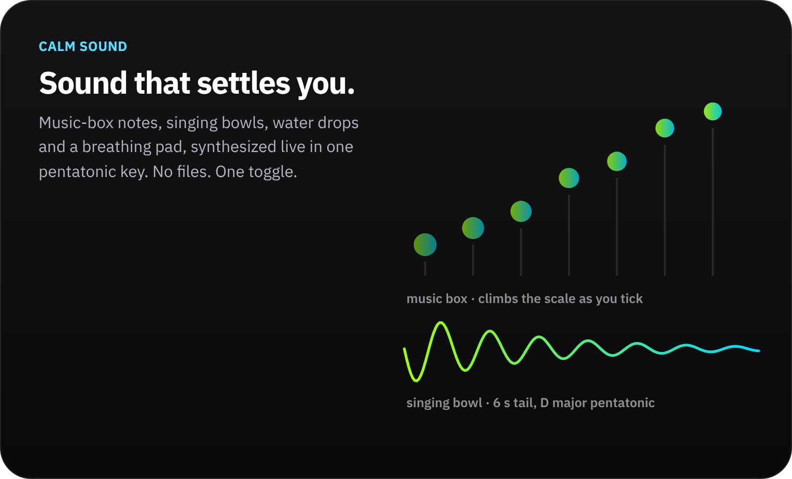</a></td>
    <td><a href="docs/11-print-and-pdf.md">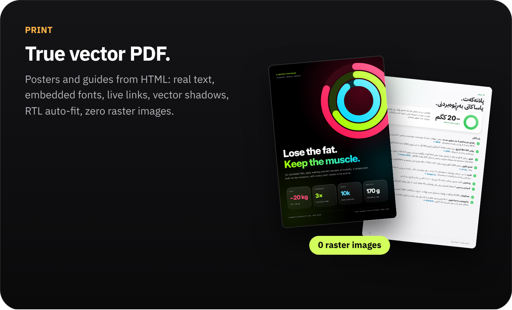</a></td>
  </tr>
  <tr>
    <td><a href="docs/02-color.md">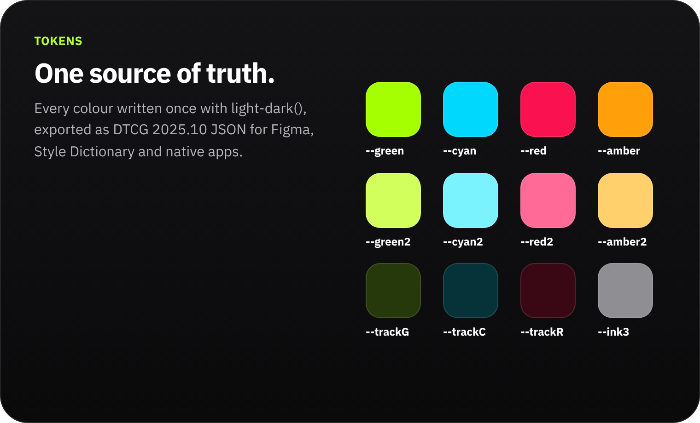</a></td>
    <td><a href="docs/13-qa.md">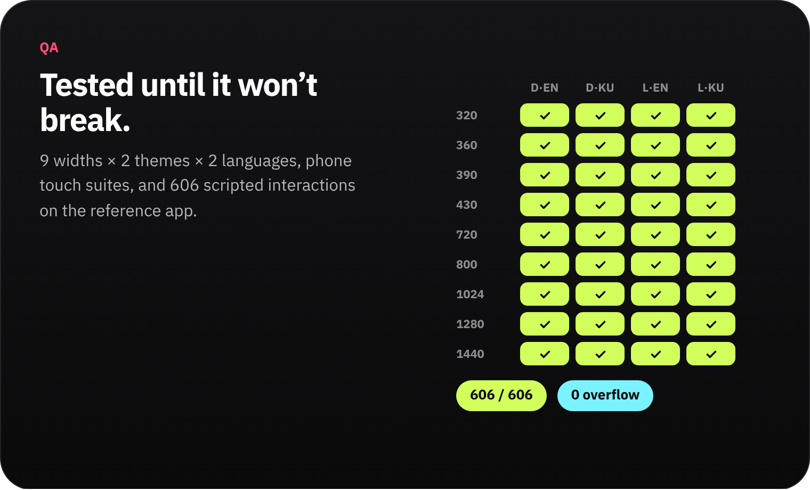</a></td>
  </tr>
</table>

| | |
|---|---|
| **Tokens** | One `tokens.css` written with `light-dark()`, plus [DTCG 2025.10](https://www.designtokens.org/tr/2025.10/) JSON for Figma, Style Dictionary and native apps |
| **Components** | Nav with scroll progress, stat tiles, activity rings, cards with pinned footers, chips, filters, segmented control, stepper, check dots, KPI row, charts, sources list, sheet dialog, timer pill, toast |
| **Creative direction** | A design brief, a signature-visual catalogue, accent-meaning and illustration rules, worked briefs for finance, ops, courses and research |
| **Runtime** | `halo.js`, no dependencies: theme, i18n, nav, rim light, reveals, drift, swipe, haptics, dialogs, toast, timer, rings, sparklines, icons |
| **Templates** | `starter.html` (personal app) · `dashboard.html` (ops / data) · `print-a4.html` (vector print) · `brief.md` |
| **Sound** | `halo-sound.js`: music box, singing bowl, water drops and a breathing pad, synthesized with Web Audio in D major pentatonic |
| **Icons** | Lucide-compatible UI icons, glyphs, and a pictogram grammar for "explain a movement" illustrations |
| **Print** | HTML → vector PDF: zero raster images, vector shadows, RTL auto-fit, a verifier |
| **QA** | Playwright suites for layout (9 widths × 2 themes × 2 languages) and phone touch |
| **Reproducible** | Pinned `requirements.txt`, a `Makefile`, a self-check (`make check`) and a GitHub Actions workflow that runs everything |
| **Docs** | 17 short files, one concern each, written for agents *and* people |

## One system, many products

<p align="center">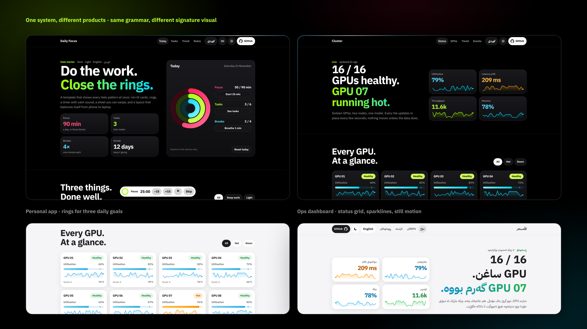</p>

Halo fixes the *grammar*: tokens, type, motion, accessibility, bilingual layout and QA. The *character* is invented per product. Before writing markup, the agent fills in a ten-line [brief](templates/brief.md) and chooses a **signature visual** from the [catalogue](docs/00-creative-direction.md):

| The user checks… | Signature visual |
|---|---|
| progress toward a few daily goals | rings |
| a value and its trend | big number + sparkline |
| a budget or a limit | meter with a target marker |
| a path through steps | segmented progress / timeline |
| many similar units' health | status grid |
| comparisons | bars with values |
| reading or reference | a typographic hero |

The two templates show the range: [`starter.html`](templates/starter.html) (a personal app with rings, a timer, a sheet and sound) and [`dashboard.html`](templates/dashboard.html) (an ops screen with a status grid, sparklines, meters with targets, live data and still motion; no rings, no sound).

## Bilingual from the first line

<p align="center">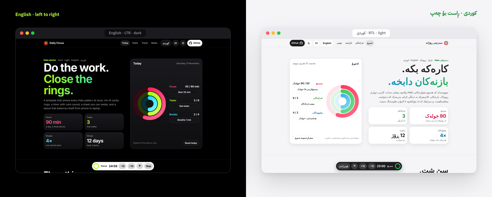</p>

Halo treats right-to-left as a first-class layout, not a mirror applied at the end. That means:
- IBM Plex Sans Arabic for Kurdish, Arabic and Persian script;
- logical CSS properties throughout;
- charts mirrored in code, and timers and rings that run counter-clockwise;
- a Sorani calendar table and `<bdi>` rules for mixed text;
- a translation workflow for a human or agent translator.

See [`docs/08-rtl-and-kurdish.md`](docs/08-rtl-and-kurdish.md).

<p align="center">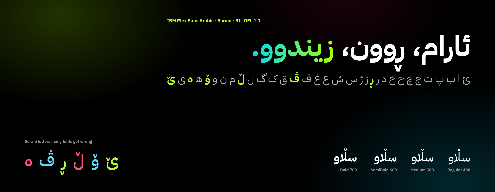</p>

## Made for phones, balanced on laptops

<p align="center">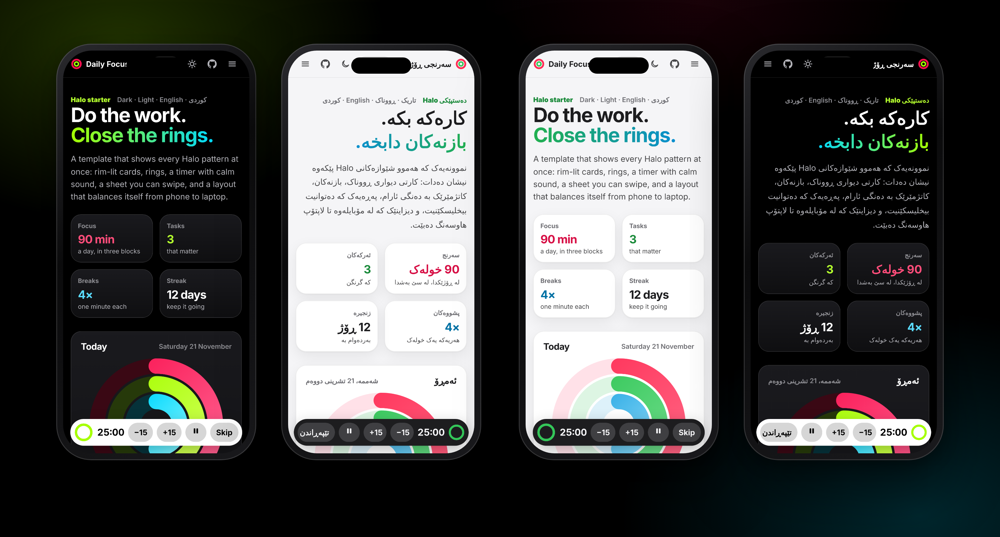</p>

On phones Halo uses:
- a quiet 40 px nav with four controls, with settings in the menu;
- swipe between items, haptics, safe areas, and a floating timer that stays usable over sheets.

On laptops it uses five balancing techniques (equal-height splits, header rows, pinned footers, content that fills its card, ratios set by content) so wide screens have no empty holes. See [`docs/04-layout.md`](docs/04-layout.md).

## Install as a skill

**Claude Code and Claude apps:** clone into your skills folder:
```bash
# for every project
git clone https://github.com/SawabS/halo-design-skill ~/.claude/skills/halo-design
# or for one project
git clone https://github.com/SawabS/halo-design-skill .claude/skills/halo-design
```
The agent loads [`SKILL.md`](SKILL.md) when a task matches, or when you ask for *"the Halo style"*.

**Codex, Cursor, Windsurf and other agents:** point them at [`SKILL.md`](SKILL.md); an [`AGENTS.md`](AGENTS.md) is included for tools that look for one.

**By hand:** serve the repo (`python3 -m http.server`) and open `templates/starter.html` or `templates/dashboard.html`.

**Verify your clone** (the same steps CI runs):
```bash
make setup      # pinned Python deps + Chromium (needs poppler-utils and qpdf from your package manager)
make check      # links, tokens in sync, no colour literals, no logos, JS syntax, EN/KU dictionaries
make qa         # layout + touch suites on both templates and the example
```

## Quick start
```html
<link href="https://fonts.googleapis.com/css2?family=Google+Sans:wght@400..700&family=IBM+Plex+Sans+Arabic:wght@400;500;600;700&display=swap" rel="stylesheet">
<link rel="stylesheet" href="tokens/tokens.css">
<link rel="stylesheet" href="css/halo.css">
<script src="js/halo.js"></script>
<script src="js/halo-sound.js"></script> <!-- optional -->
<script>
  Halo.init({ dict: { en: { hello: "Hello" }, ckb: { hello: "سڵاو" } } });
</script>
```
```html
<div class="card stat">
  <div class="label">Goal</div>
  <div class="v tone-red">−20 kg</div>
  <div class="s">105 → 85 kg</div>
</div>
```
Using React, Next.js, Tailwind v4 or shadcn/ui? See [`docs/17-frameworks.md`](docs/17-frameworks.md).

## Design tokens

<p align="center">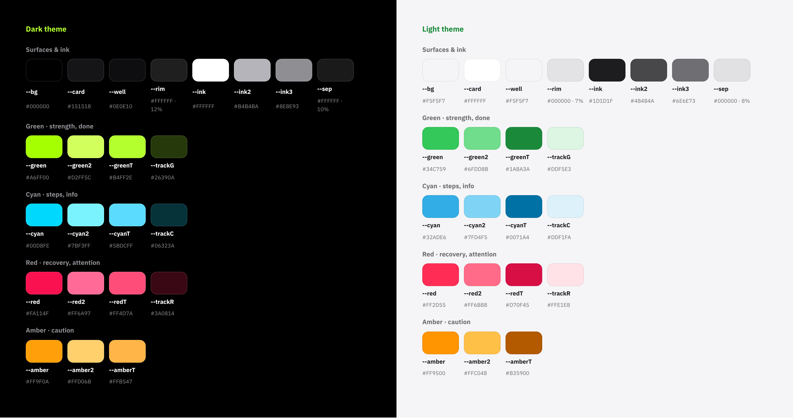</p>

Three accents with four roles each (fill, gradient partner, text-safe tone, track), surfaces and ink for both themes, written once in [`tokens/tokens.css`](tokens/tokens.css) and exported as DTCG JSON. See [`docs/02-color.md`](docs/02-color.md).

## Pictograms

<p align="center">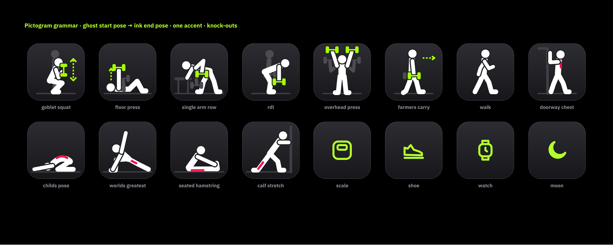</p>

A grammar for drawing movements: a ghost start pose, an ink end pose, equipment and motion in a single accent, and knock-outs where limbs cross. It works for exercises, cooking steps, gestures and assembly. See [`icons/README.md`](icons/README.md).

## Print, without a single raster image

<p align="center">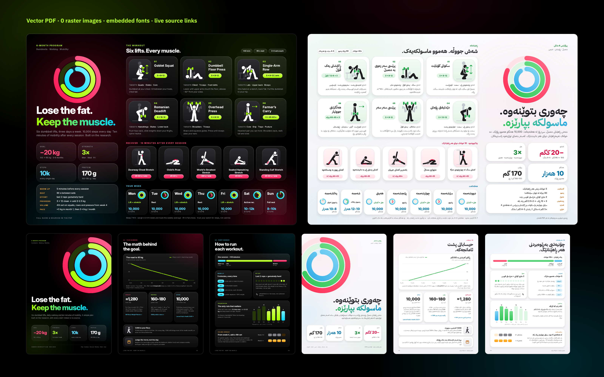</p>

HTML at the exact paper size → headless Chromium → `qpdf` merge → `verify_pdf.sh` (must report **0 images**). Real text, embedded TrueType fonts, live links, vector shadows and Kurdish auto-fit. See [`docs/11-print-and-pdf.md`](docs/11-print-and-pdf.md).

## Built on standards and proven libraries

Halo's runtime uses only Baseline web-platform APIs: `light-dark()`, `<dialog>`, IntersectionObserver, ResizeObserver, Pointer Events, `Intl`, Web Audio and the Vibration API. When a library is the better tool, the docs name it and map Halo onto it:

**Motion** · **GSAP ScrollTrigger** · **Lenis** · **Magic UI** · **vanilla-tilt** · **Lucide** · **Tone.js** · **ECharts** · **Playwright** · **axe-core** · **Style Dictionary** · **Fontsource**

The full one-to-one map is in [`docs/16-libraries.md`](docs/16-libraries.md).

## The reference product

<p align="center">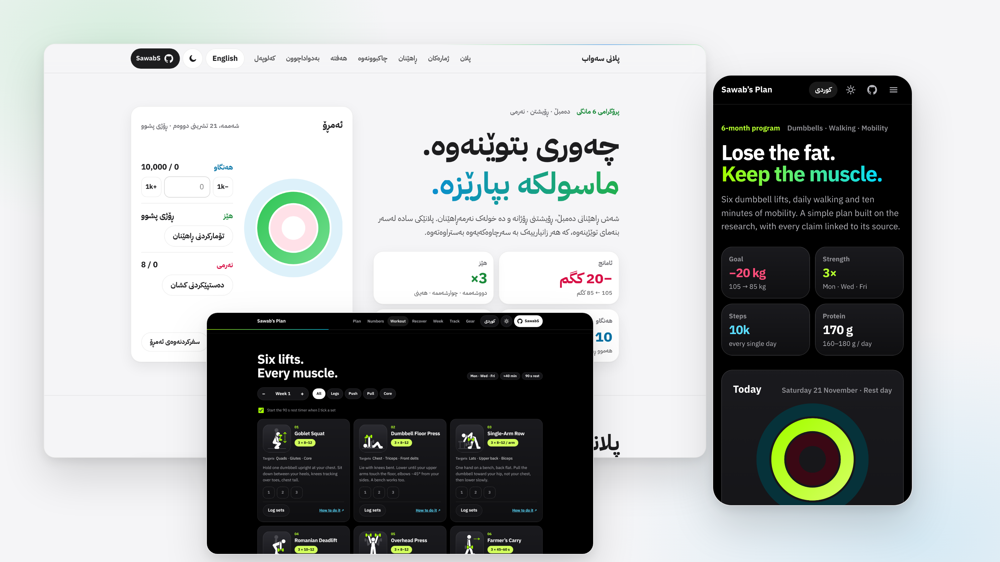</p>

[`examples/workout-plan`](examples/workout-plan) is the project Halo was extracted from. It is a six-month workout plan built two ways:
- an interactive site with rings, a workout logger with rest timer, a guided stretch player, a projection calculator, a weigh-in tracker and sources;
- 10-page vector PDFs in English and Kurdish, dark and light.

It passed **606 scripted interaction checks**, plus the layout and touch suites.

## Repository layout
```
SKILL.md              agent entry point: workflow, rules, checklist
AGENTS.md             pointer for non-Claude agents
tokens/               tokens.css + DTCG JSON (light, dark, base)
css/halo.css          components, motion, phone, RTL, print
js/halo.js            runtime (no dependencies)
js/halo-sound.js      calm synthesized sound
templates/            brief.md · starter.html · dashboard.html · print-a4.html
icons/                ui · glyphs · pictograms · grammar · gallery
docs/                 01–17, one concern per file · assets/ (these images + studio source)
qa/                   qa_layout.py · qa_touch.py
scripts/              check_skill.py · print_pdf.py · verify_pdf.sh · build_tokens.py · render_assets.py
Makefile              setup · check · qa · assets · tokens · pdf-verify · all
requirements.txt      pinned Python dependencies
.github/workflows/    CI running make check, make qa, make pdf-verify
fonts/                IBM Plex Sans Arabic + Inter (TrueType, OFL)
examples/workout-plan the reference product: site + 4 vector PDFs
```

## Docs
| | | |
|---|---|---|
| [**00 Creative direction**](docs/00-creative-direction.md) | | |
| [01 Principles](docs/01-principles.md) | [07 Phone & touch](docs/07-phone-and-touch.md) | [13 QA](docs/13-qa.md) |
| [02 Colour](docs/02-color.md) | [08 RTL & Kurdish](docs/08-rtl-and-kurdish.md) | [14 Sound](docs/14-sound.md) |
| [03 Typography](docs/03-typography.md) | [09 Icons](docs/09-icons.md) | [15 Figma](docs/15-figma.md) |
| [04 Layout](docs/04-layout.md) | [10 Data viz](docs/10-data-viz.md) | [16 Libraries](docs/16-libraries.md) |
| [05 Components](docs/05-components.md) | [11 Print & PDF](docs/11-print-and-pdf.md) | [17 Frameworks](docs/17-frameworks.md) |
| [06 Motion & light](docs/06-motion-and-light.md) | [12 Accessibility](docs/12-accessibility.md) | |

## Regenerating these images
Every image in this README is rendered from live Halo pages, so it stays true to the code:
```bash
make assets                          # starts a local server, captures pages, renders docs/assets/*.png
```
The source is [`docs/assets/src/studio.html`](docs/assets/src/studio.html): each `[data-asset]` element is one image.

## Contributing
Issues and pull requests are welcome, especially:
- translations and review of the Kurdish strings;
- new pictograms that follow the grammar;
- framework recipes.

Please run `make all` before opening a pull request; CI runs the same steps.

## Licence
- Code and docs: [MIT](LICENSE).
- Fonts in `fonts/`: SIL Open Font License 1.1. Google Sans loads from Google Fonts (OFL).
- Third-party projects are referenced, not bundled; see [`NOTICE.md`](NOTICE.md).

<p align="center"><sub>Made by <a href="https://github.com/SawabS">Sawab Hussein</a></sub></p>
